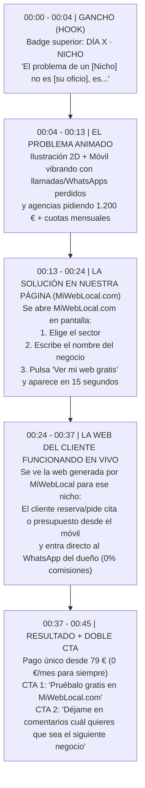

# Manual de Ingeniería Inversa: Cómo Replicar los Vídeos de `@alejandroo.ia` (100% Sin Mostrar la Cara) para `MiWebLocal.com`

> [!IMPORTANT]
> **Sí, he visto y analizado fotograma por fotograma cómo hace los vídeos** (incluyendo sus vídeos más virales como **Día 2: Talleres con 189.700 views**, **Día 16: Peluquerías con 62.400 views**, **Día 4: Clínicas Dentales con 16.400 views**, **Día 14: Bares de copas**, y los dos vídeos donde enseña su pantalla revelando su secreto de edición: **Vídeo #36** y **Vídeo #22**).

---

## 1. Cómo Hace y Edita `@alejandroo.ia` sus Vídeos con Claude (El Secreto Técnico Real)

En los vídeos [#36](https://www.tiktok.com/@alejandroo.ia/video/7689129622427995414) (*"Así es como edito mis vídeos"*) y [#22](https://www.tiktok.com/@alejandroo.ia/video/7692860130949451041) (*"Opus + Remotion"*), Alejandro muestra su monitor y revela que **no edita en Premiere ni en CapCut**. Utiliza **Claude Code** conectado a **Remotion** (`@remotion/transitions`) y **HyperFrames** mediante una *skill* propia llamada `editar-video`:

### 1.1. Estructura de su Skill `editar-video` (vista en el segundo `00:11` del Vídeo #36)
```yaml
name: editar-video
description: "Edita vídeos verticales: cortes, subtítulos, animaciones, efectos y exportación final."
references:
  - references/montaje.md     # Reglas de ritmo, corte de silencios y estructura de 45s
  - references/animacion.md   # Ilustraciones 2D del problema (mecánico, barbero, camarero...)
  - references/motion.md      # Físicas spring (muelles), cursores animados, contadores y tarjetas UI
  - references/diseno.md      # Tipografía Inter, formato 1080x1920 a 30fps, paleta limpia y sombras
```

### 1.2. El Flujo de 6 Pasos Automatizados que Ejecuta Claude
1. **Detecta los silencios:** Analiza el audio de la locución y localiza cada pausa de respiración (`> 0.18s`).
2. **Recorta al fotograma (`Silencios fuera`):** Elimina todos los tiempos muertos para que el ritmo sea continuo y rápido.
3. **Transcribe con `Whisper large-v3`:** Genera subtítulos dinámicos de **2 a 4 palabras por línea**, en mayúsculas, tipografía `Inter` Bold blanca con borde/sombra negra, sincronizados al milisegundo.
4. **Genera la Animación en Código (Remotion / HTML5 `1080x1920` a `30 fps`):**
   - En lugar de grabar una app real complicada, **Claude escribe un componente React/HTML animado** que simula la historia visual en dos actos:
     - **Acto 1 (El Problema en dibujo 2D):** Un personaje minimalista (el mecánico junto al coche naranja, el peluquero cortando el pelo) siendo interrumpido por un móvil que vibra (`2, 4, 6, 10 llamadas` / `"¿Está listo mi coche?"`) hasta que sale un cartel rojo: **`TIEMPO PERDIDO`**.
     - **Acto 2 (La Solución en interfaz UI limpia):** Tarjetas blancas con bordes redondeados, un cursor circular que hace clic solo, campos que se rellenan solos con animaciones de muelle (*spring*), etiquetas que cambian de naranja a verde (**`✓ APROBADO`**, **`✓ PAGADO`**, **`✓ LIBRE`**) y contadores que bajan de `10 llamadas` a **`0 llamadas`**.
5. **Añade Efectos de Sonido (SFX):** Sincroniza *whooshes* en los cambios de pantalla, vibración de teléfono en el problema, *clicks* cuando el cursor pulsa un botón y un *ding* de éxito cuando sale el check verde.
6. **Exporta a `.mp4` (`1080x1920`, 30 fps):** Listo para publicar en TikTok, Instagram Reels y YouTube Shorts.

---

## 2. Cómo Adaptarlo a Nuestro Canal: 100% Sin Mostrar la Cara (Faceless) y Mostrando `MiWebLocal.com`

En los vídeos de Alejandro, la mitad inferior de la pantalla es simplemente él hablando en su habitación y la mitad superior es la animación hecha con Claude (y en las partes clave, la animación ocupa toda la pantalla).

**Para nuestro canal de `MiWebLocal.com`, hacerlo SIN mostrar la cara es una ventaja enorme** porque el 100 % de la pantalla vertical (`1080x1920`) se convierte en un **escenario visual hipnótico**:



### ¿Qué cambia respecto a Alejandro para que venda `MiWebLocal.com`?
1. **En vez de enseñar un software inventado que requiere programación a medida de miles de euros**, cuando decimos *"Así que hemos hecho esto en nuestra página"*, **enseñamos `MiWebLocal.com` en acción**:
   - Primero se ve lo fácil que el dueño del negocio entra en **`miweblocal.com`**, toca el botón de su sector (ej. *Motor y Taller*, *Peluquería y Estética*, *Reformas*, *Clínica*, *Restaurante*), escribe el nombre de su negocio y en **15 segundos** ve su web real funcionando.
   - Segundo, hacemos zoom dentro de **esa web generada en `MiWebLocal.com`** mostrando cómo resuelve exactamente el problema de su sector (la reserva de cita con servicio/profesional, la solicitud de cita de taller con matrícula y síntoma, la carta digital con reserva de mesa, el formulario de presupuesto de reforma...) enviándolo todo ordenado al WhatsApp del dueño con **0 % de comisiones**.
2. **Rematamos el dolor del precio en España:** Mientras una agencia les pide `1.200 €` y cuotas todos los meses, en **`MiWebLocal.com`** la prueban gratis durante 24 horas y se la quedan en propiedad para siempre con un **pago único desde 79 € (0 €/mes)**.

---

## 3. Anatomía Visual de Pantalla Completa (Sin Cara — Formato `1080x1920`)

Para que el vídeo no necesite a nadie en cámara y retenga la atención desde el segundo 1, la pantalla `9:16` se divide en **3 zonas limpias**:

| Zona de la Pantalla (`1080x1920`) | Qué Muestra en Todo Momento | Estilo Visual |
| :--- | :--- | :--- |
| **1. Cabecera Fija (`Top 15%`)** | Píldora de serie: `SOLUCIONES PARA NEGOCIOS · EPISODIO #01` + Título grande del nicho: **`TALLERES MECÁNICOS`** / **`PELUQUERÍAS`** | Fondo claro `#FAFBFD`, tipografía `Outfit` ExtraBold, color acento `#4F46E5` (el mismo diseño exacto de `MiWebLocal.com`). |
| **2. Escenario Central (`Center 65%`)** | Donde ocurre toda la acción animada a 60 fps:<br>• **0–13s:** Animación del caos del negocio (llamadas, clientes que se van, presupuestos lentos).<br>• **13–24s:** Ventana de `miweblocal.com` escribiendo el nombre del negocio en directo y generando la vista previa.<br>• **24–37s:** El móvil del cliente reservando en la web generada + el WhatsApp del dueño recibiendo el pedido/cita estructurado. | Tarjetas con doble bisel (`.bz` y `.bz-in` de `MiWebLocal.com`), cursores animados con onda al hacer clic, barras de progreso y etiquetas verdes `#10B981`. |
| **3. Banda de Subtítulos + Audio (`Bottom 20%`)** | Subtítulos grandes de 2 a 4 palabras sincronizados con la voz en off (resaltando la palabra clave en azul/verde) + barra inferior con `miweblocal.com · Prueba tu web en 15 segundos`. | Fuente `Outfit` 800, tamaño `56px`, sombra suave y animación *pop* en cada palabra. |

---

## 4. Guiones Exactos (Palabra por Palabra) + Storyboard para los Primeros 8 Vídeos de Nuestro Canal

Todos estos guiones están copiados de la estructura ganadora de Alejandro (38–45 segundos, ritmo rápido, sin paja), pero **100 % adaptados a `MiWebLocal.com`** para que el espectador vea el problema de su negocio y cómo nuestra página se lo soluciona al instante:

### Vídeo 1: Talleres Mecánicos (Inspirado en su vídeo más viral de 189.700 views)
- ** Hook (0–4s):**
  - *Voz:* «El problema de un taller mecánico no es arreglar coches. Es que te llamen diez veces al día para preguntar precios o pedir cita mientras estás debajo de un elevador.»
  - *Pantalla:* Coche en elevador + móvil vibrando sin parar (`10 llamadas perdidas`) + mecánico soltando la llave inglesa (`TIEMPO PERDIDO`).
- **Agudización del Problema (4–12s):**
  - *Voz:* «Cada llamada son diez minutos que sueltas la herramienta. Y si encima quieres hacerte una web para evitarlo, una agencia te pide mil euros y cuotas todos los meses.»
  - *Pantalla:* Presupuesto tachado de `Agencia: 1.200 € + 50 €/mes ❌`.
- **La Solución en Nuestra Página (12–25s):**
  - *Voz:* «Por eso hemos creado esto en nuestra página. Entras en MiWebLocal punto com, eliges Motor y Taller, escribes el nombre de tu taller y tu ciudad, y en quince segundos tienes tu propia página web funcionando.»
  - *Pantalla:* Se abre el generador real de `MiWebLocal.com`, el cursor selecciona **Motor y Taller**, escribe `"Taller Precisión Alicante"`, pulsa **Ver mi web gratis** y se despliega la web del taller al instante.
- **Cómo Funciona para el Cliente del Taller (25–37s):**
  - *Voz:* «Ahora, cuando un cliente busca tu taller, ve tus servicios con precios claros, escribe su matrícula, qué síntoma tiene el coche —como un ruido al frenar— y pide cita con un botón. A ti te llega la ficha completa directo a tu WhatsApp sin que suene el teléfono.»
  - *Pantalla:* Móvil mostrando la web del taller -> cliente rellena `Seat León · 4821 KLB · Ruido al frenar` -> pulsa `Pedir cita por WhatsApp` -> entra mensaje ordenado al WhatsApp del taller (`0 llamadas · 0% comisiones`).
- **Cierre + Doble CTA (37–45s):**
  - *Voz:* «Sin cuotas mensuales: un pago único desde setenta y nueve euros y es tuya para siempre. Entra en MiWebLocal punto com para ver cómo queda con el nombre de tu taller y dime en comentarios qué negocio quieres que hagamos mañana.»
  - *Pantalla:* Tarjeta final `miweblocal.com` (`Desde 79 € · Pago único · 0 €/mes`) + etiqueta `¿SIGUIENTE NEGOCIO? DÉJALO EN COMENTARIOS 👇`.

---

### Vídeo 2: Peluquerías y Barberías (Inspirado en su 2.º vídeo de nicho más viral: 62.400 views)
- **Hook (0–4s):**
  - *Voz:* «El problema de un peluquero o un barbero no es cortar el pelo más rápido. Es tener que parar cada quince minutos con las tijeras en la mano para contestar WhatsApps de "¿tienes hueco hoy?".»
- **Problema (4–12s):**
  - *Voz:* «Si no contestas al momento, ese cliente se va a otra barbería. Y si usas aplicaciones de reservas externas, te cobran suscripción todos los meses o comisiones por cada corte.»
- **La Solución en Nuestra Página (12–24s):**
  - *Voz:* «Mira cómo lo solucionamos en nuestra página. Entras en MiWebLocal punto com, tocas Peluquería y Estética, escribes el nombre de tu salón y en quince segundos ves tu web lista con tu nombre.»
- **Flujo en Vivo (24–36s):**
  - *Voz:* «Tu cliente entra desde el móvil, ve tu carta de cortes, degradados o mechas con sus precios, elige el servicio, el día y la hora, y te envía la reserva cerrada directo a tu WhatsApp con cero por ciento de comisión.»
- **Cierre + CTA (36–44s):**
  - *Voz:* «Sin comisiones y sin pagar cuotas mensuales nunca más. Pruébala gratis ahora mismo con el nombre de tu peluquería en MiWebLocal punto com y déjame en comentarios cuál quieres que sea el siguiente negocio.»

---

### Vídeo 3: Clínicas Dentales y Fisioterapia (Inspirado en su Día 4: 16.400 views)
- **Hook (0–4s):**
  - *Voz:* «Muchos pacientes buscan dentista o fisio a las diez de la noche desde el sofá. Si tu clínica no tiene web o solo tiene un teléfono fijo, a esa hora no llaman: reservan en la clínica de enfrente.»
- **La Solución en Nuestra Página (12–35s):**
  - *Voz:* «En nuestra página lo hemos resuelto en quince segundos. Entras en MiWebLocal punto com, seleccionas Clínica y Salud, pones el nombre de tu clínica y tu ciudad, y al instante se genera tu web médica con tus tratamientos, equipo, horarios, ubicación en Google Maps y botón de primera visita directo a tu WhatsApp.»
- **Cierre + CTA (35–43s):**
  - *Voz:* «Así tu clínica capta pacientes veinticuatro horas sin pagar agencias caras ni mensualidades. Haz la prueba gratis con el nombre de tu clínica en MiWebLocal punto com y comenta qué negocio hacemos en el próximo vídeo.»

---

### Vídeo 4: Empresas de Reformas, Fontaneros y Electricistas (Inspirado en su Día 5: 7.700 views)
- **Hook (0–4s):**
  - *Voz:* «Si trabajas en reformas, fontanería o electricidad, tu mayor pérdida de tiempo son los curiosos que te llaman diez veces para pedir precios sin saber ni qué quieren hacer.»
- **La Solución en Nuestra Página (12–35s):**
  - *Voz:* «Mira lo que hemos montado en nuestra página. Entras en MiWebLocal punto com, eliges Reformas y Oficios, escribes tu nombre y en quince segundos tienes una web profesional que enseña tus trabajos terminados, genera confianza inmediata y filtra a los clientes con un formulario que te manda al WhatsApp qué reforma quieren, en qué zona están y cuándo quieren empezar.»
- **Cierre + CTA (35–43s):**
  - *Voz:* «Te quitas curiosos y cierras obras de verdad con un solo pago único para siempre. Crea tu vista previa gratis en MiWebLocal punto com y pon en comentarios el siguiente oficio.»

---

### Vídeo 5: Restaurantes, Bares y Cafeterías (Inspirado en su Día 11 y Día 14)
- **Hook (0–4s):**
  - *Voz:* «Viernes a las nueve de la noche. Tienes el restaurante lleno, suena el teléfono para reservar mesa y un camarero tiene que dejar tres platos enfriándose en la barra para apuntarlo en una libreta.»
- **La Solución en Nuestra Página (12–35s):**
  - *Voz:* «En nuestra página lo solucionas en quince segundos. Entras en MiWebLocal punto com, eliges Restaurante y Bar, pones el nombre de tu local y se crea al instante tu web con tu carta digital para el móvil, tus platos estrella, tu mapa y un sistema de reserva de mesa que llega ya confirmado a tu WhatsApp con el día, la hora y el número de comensales.»
- **Cierre + CTA (35–43s):**
  - *Voz:* «Nadie te frena el servicio y no pagas comisiones por comensal. Mira cómo queda la web de tu restaurante gratis en MiWebLocal punto com y dime en comentarios el próximo negocio.»
